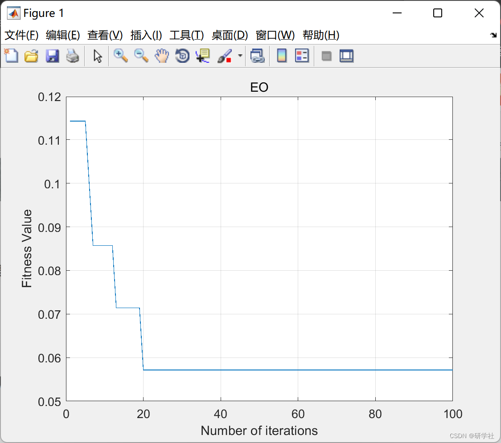
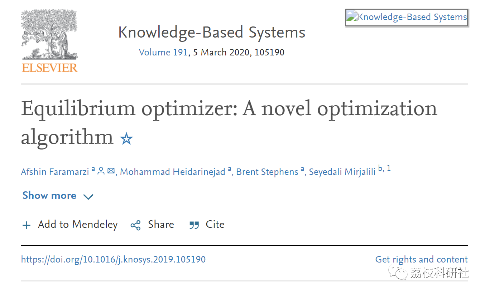

# Application of Balanced Optimization Algorithm in Feature Selection (Matlab Code Implementation)

​  
💥💥💥💞💞💞 Welcome to this blog❤️❤️❤️💥💥💥 🏆 Bloggers' Advantage: 🌞🌞🌞 The content of the blog strives for rigorous thinking and clear logic, making it convenient for readers. ⛳️ Mantra: "A journey of a thousand miles begins with a single step." 1 Overview📚 2 Run Results🎉 3 References🌈 4 MATLAB Code Implementation 💥 1 Overview Balanced Optimizer (EO) is inspired by the control volume mass balance model used to estimate dynamic and balanced states. In EO, each particle (solution) and its concentration (position) serve as the search agent. The search agent randomly updates its concentration relative to the best solution so far (i.e., the balanced candidate), aiming to ultimately reach the equilibrium state (best result). A well-defined term for "generation rate" has been proven to stimulate the exploration capabilities of EO.
​  
Editor
📚2 Running Results Editing
🎉3 References
Editor
Partial code: %---Inputs----------------------------------------------------------- % feat  : feature vector (Instances x Features) % label  : label vector (Instances x 1) % N    : Number of particles % max_Iter : Maximum number of iterations % a1   : Parameter % a2   : Parameter % GP   : Generation rate control parameter %---Output----------------------------------------------------------- % sFeat  : Selected features (Instances x Features) % Sf   : Selected feature index % Nf   : Number of selected features % curve  : Convergence curve %--------------------------------------------------------------------
%% Equilibrium Optimizer clc, clear, close; % Benchmark data set  load ionosphere.mat; % Set 20% data as validation set ho = 0.2; % Hold-out method HO = cvpartition(label,'HoldOut',ho); % Parameter setting N    = 10; max_Iter = 100; a1   = 2; % constant a2   = 1; % constant GP   = 0.5; % generation probability % Equilibrium Optimizer [sFeat,Sf,Nf,curve] = jEO(feat,label,N,max_Iter,a1,a2,GP,HO); % Plot convergence curve plot(1:max_Iter,curve); xlabel('Number of iterations'); ylabel('Fitness Value'); title('EO'); grid on; 🌈4 Matlab code implementation
​  

## Images

<!-- PAYMENT_BLOCK -->

## Get this dataset

- Payment link (Stripe): [Buy now](https://buy.stripe.com/3cs8yP7sY87d0vu9AB)
- Payment QR code: 

<!-- /PAYMENT_BLOCK -->
